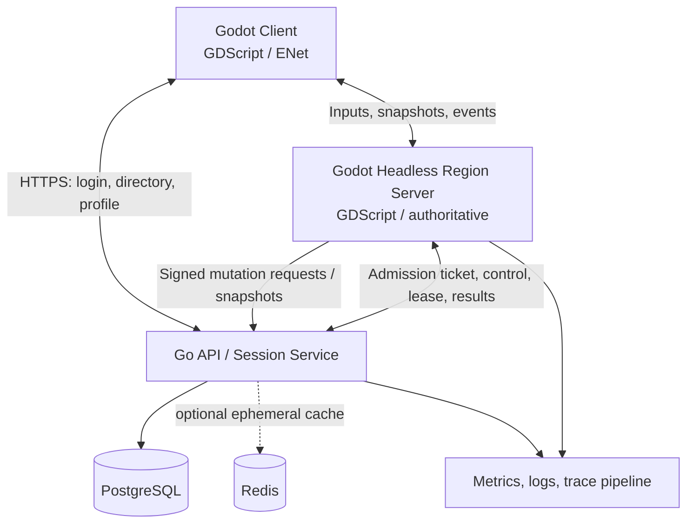

# Samurai Assassin — Technical Architecture

> **Status:** Proposed architecture v0.1 · **Stack constraint:** **GDScript + Go only** for authored game/server/application logic. SQL and config/schema formats are permitted; no C#, C++ or TypeScript dependency is required.  
> **Game design:** [GDD.md](GDD.md) · **Networking specification:** [MULTIPLAYER.md](MULTIPLAYER.md)

## 1. Executive decision

Use **Godot 4.x with GDScript** for the playable 3D client **and authoritative headless game simulation**, and **Go** for accounts, session admission, matchmaking/server directory, persistence gateway, social/account APIs, administration and operational tooling.

This is an intentional hybrid, not two competing combat servers:

- **Godot headless owns real-time state:** movement, posture, collision, attacks, hit registration, ability effects, AI, zone rules, loot containers and combat-time item eligibility.
- **Go owns durable/account state and orchestration:** identity, inventory ledger persistence, item ownership validation, matchmaking/admission, economy transactions, server leases, reconnect authorization and audit.
- **PostgreSQL** is the durable source of truth for characters, ownership, skills, item instances and transactions.
- **Godot client** owns presentation, local input, camera, prediction, animation/audio and visual effects. It never independently awards damage, items or skills.

**Why this route?** Godot headless provides the same GDScript gameplay logic and physics primitives to client and server and allows early multiplayer combat iteration without implementing a second full 3D collision/simulation stack in Go. This is more practical for this game than choosing Go-only authoritative combat at the start. We can later benchmark selective reimplementation behind a well-defined protocol without making that a prerequisite.

**Critical constraint:** Godot's high-level multiplayer protocol is designed for Godot peers, not a public wire standard for arbitrary Go clients. **Client ↔ headless game server uses Godot's high-level multiplayer over ENet**. **Go ↔ game server uses a separate authenticated HTTP/JSON control API** (or a versioned binary service protocol if benchmarks justify it). Do not have Go attempt to speak Godot's scene RPC format. The Go control plane is **not** on every movement/hit packet path.

## 2. Goals and non-goals

### Goals

- One coherent source of truth for combat, death and item ownership.
- Reusable ability effects, status modifiers, equipment and content definitions.
- Small modules with explicit dependencies and testable pure rules.
- Fast local iteration, fully headless dedicated servers, reproducible builds.
- Safe persistence under disconnects, crashes and concurrent actions.
- Observability for tick duration, bandwidth, lag, combat, economy and abuse.
- Scale by independent region/world instances; do not promise seamless MMO distributed physics.

### Non-goals (initial)

- Kubernetes-first deployment, Kafka-style event pipelines, arbitrary microservices per gameplay mechanic, seamless global world state, scripting user-made abilities, an ECS rewrite of Godot's entire scene system, exact client-side authority, large live-service monetization backend.

## 3. System context



**Traffic paths:** Low-latency gameplay traffic is directly between client and region server. Go is used at session setup and important durable transitions, not on every animation frame. Go issues short-lived signed tickets; Godot game server validates them through a secure method, binds ticket to account/character and single-session lease, and only then enables gameplay commands.

## 4. Responsibility matrix

| System | Client Godot | Dedicated Godot | Go services / DB |
|---|---|---|---|
| Camera, HUD, particles, scarves | Owns | None | None |
| Local movement feel/prediction | Predicts | Validates authoritative movement | None |
| Attack timing, hitboxes, posture | Displays/anticipates | **Owns** combat result | Logs notable events |
| Ability cooldowns, gem effect triggers | Displays predicted UI | **Owns** live effect execution | Stores learned/equipped definitions |
| Enemy AI/boss logic | Displays | **Owns** | Stores progression rewards |
| Bag/ground-loot transitions | Displays | Serializes actions and zone eligibility | **Owns durable transaction/ledger** |
| Skill learn, crafting, banking | Requests | Verifies context, applies on acknowledgement | **Commits ownership** |
| Character login, tickets, server listing | Requests | Validates admission | **Owns** |
| Party/region presence | Displays | Real-time party state and combat lock | Cross-session party metadata; room assignment |
| Account economy, authoritative item ledger | Read-only presentation | Holds limited session cache | **Owns** |
| Metrics and abuse indicators | UX signals | Tick/combat/performance logs | Account/economy/audit logs |

Rule: any operation that creates, consumes, trades, secures or transfers an item is a **durable transaction** coordinated by Go, with Godot game server enforcing spatial/gameplay eligibility. Do not rely solely on eventual async logs for financial-equivalent item state.

## 5. Source tree (recommended monorepo)

```text
samurai-assassin/
├── README.md
├── docs/
│   ├── GDD.md
│   ├── ARCHITECTURE.md
│   ├── MULTIPLAYER.md
│   ├── decisions/                 # ADR-0001 etc.
│   └── playtests/
├── game/                           # Godot 4.x project (GDScript)
│   ├── project.godot
│   ├── addons/                     # vetted, minimal dependencies
│   ├── assets/                     # 3D, audio, VFX, animations
│   ├── scenes/
│   │   ├── bootstrap/
│   │   ├── characters/
│   │   ├── regions/
│   │   ├── enemies/
│   │   ├── weapons/
│   │   ├── pickups/
│   │   └── ui/
│   ├── scripts/
│   │   ├── core/                   # immutable identifiers, event payloads
│   │   ├── combat/                 # state, hit resolution, posture, damage
│   │   ├── abilities/              # activation, effect interpreter, weaving
│   │   ├── equipment/              # weapon stances, sockets, stat budgets
│   │   ├── inventory/              # UI + authoritative in-session policy
│   │   ├── actors/                 # player/enemy components
│   │   ├── world/                  # zone rules, spawns, dungeon rules
│   │   ├── multiplayer/            # transport, replication, prediction
│   │   ├── server/                 # admission, persistence bridge, lifecycle
│   │   └── presentation/           # camera, UI viewmodels, VFX
│   ├── data/                       # validated .tres/.res authored definitions
│   └── tests/                      # Godot test runner / headless scenarios
├── backend/
│   ├── go.mod
│   ├── cmd/api/
│   ├── cmd/worker/
│   ├── cmd/loadtest/
│   ├── internal/
│   │   ├── account/
│   │   ├── identity/
│   │   ├── sessions/
│   │   ├── matchmaking/
│   │   ├── character/
│   │   ├── inventory/
│   │   ├── economy/
│   │   ├── progression/
│   │   ├── social/
│   │   ├── servercontrol/
│   │   ├── datastore/
│   │   └── telemetry/
│   ├── migrations/
│   └── tests/
├── contracts/
│   ├── control-api/                # OpenAPI/JSON schemas Go ↔ Godot
│   ├── content/                    # normalized IDs and content manifests
│   └── versions/
├── deploy/
│   ├── docker/
│   ├── compose/
│   └── config/
└── scripts/                       # export, lint, test, build
```

Folder structure is a guide, not permission for empty premature modules. Build features vertically and extract abstractions when a second real use case exists.

## 6. Godot architectural principles

### 6.1 Scene trees for representation; components for behavior

- Character scene contains model, `CharacterBody3D`, collider, AnimationTree, camera mount (client only), equipment attachment sockets and tightly scoped controllers.
- Use small GDScript components for `Health`, `Posture`, `Stamina`, `Spirit`, `StatusEffects`, `CombatState`, `AbilityLoadout`, `Equipment`, `Interaction`, `NetworkIdentity`.
- Events/signals reduce coupling between components, but **do not** make a global signal bus that hides critical control flow.
- Avoid magic global singleton state. Restrict AutoLoads to `GameBootstrap`, `NetworkSession`, `ContentCatalog`, `UIRouter`/similar true application-wide services.
- Gameplay mechanics should not import specific UI scenes or require renderer components to calculate authoritative state.

### 6.2 Clear simulation/presentation boundary

**Shared pure rules** (GDScript, testable in headless mode): cooldown validation, stat calculations, effect eligibility, damage formulas, resource caps, status interactions, loot classification.

**Server-only controllers:** authoritative movement, hit query verification, AI decisions, boss phases, pickup spawns, PvP boundary rules and game-control API requests.

**Client-only adapters:** animation, interpolation, prediction, cosmetics, user interface, audio, camera and feedback.

The server may load stripped gameplay scenes, but must not instantiate heavy cosmetic particles, high-poly cloth, cameras or audio pipelines. Use Godot dedicated-server exports and headless execution.

### 6.3 Content as data, not per-item subclasses

Use typed `Resource` definitions for `WeaponDefinition`, `GemDefinition`, `AbilityDefinition`, `BuffScrollDefinition`, `EnemyDefinition`, `DungeonDefinition`, `StatusEffectDefinition` and `LootTableDefinition`.

Author identifiers explicitly (`weapon.katana.starter.v1`) and version assets. Instance state stores the `definition_id` and individual rolls/progression, **not arbitrary GDScript code sent by the client**.

Ability effects come from a bounded library of authored operations: damage, posture damage, movement impulse, buff, status application, spawn server-owned projectile, teleport-with-validation, area query, conditional trigger. Avoid a unique subclass for every ability unless it genuinely needs a custom authored mechanic.

### 6.4 Damage/effect pipeline

```text
input intent
  → check actor state + anti-spam
  → verify loadout and resource costs
  → start authoritative ability state
  → windup / active frames / collision query
  → validate target, line of sight, i-frames, faction/PvP rules
  → resolve guard/parry/posture and status modifiers
  → apply damage & effect transaction in simulation
  → emit sequenced combat events to interested clients
  → persist notable progression / durable reward only as needed
```

Prefer one central rule path for hit resolution; do not let each weapon independently bypass guard, death or PvP checks.

### 6.5 Character state conventions

- Canonical `entity_id` remains stable within an instance; `character_id` remains stable across sessions.
- Health/stamina/posture/Spirit are authoritative integers or carefully bounded fixed-point/quantized values where helpful; avoid trusting client floats.
- `CombatState` enum/state machine owns legal transitions. Animations follow state; they do not confer client authority.
- Timers use authoritative simulation tick/time, not wall clock from a user-controlled machine.
- Server seeds controlled randomness for combat and loot; audit reward draws when valuable.

## 7. Go backend design

### Start with one Go service (modular monolith)

Group modules in one deployable Go API initially. Keep explicit interfaces and transactional boundaries between modules. Split a service only if load, reliability or ownership clearly requires it.

**Main modules:**

- `identity`: credentials/provider login, sessions, account sanctions.
- `character`: slots, profile, appearance and advancement.
- `sessions`: one active lease/character, admission tickets, region assignment and reconnect eligibility.
- `inventory`: item instances, locations, protected equipment slots, durable mutation ledger.
- `progression`: learn skill, unlock mastery, master/legacy ownership changes.
- `economy`: crafting, trades, currencies, scroll consumption, transaction audit.
- `social`: parties, blocks, bounties and Chronicle records (initially minimal).
- `servercontrol`: headless server registration, health, signed controls, checkpoint transfers.
- `telemetry`: counters, tracing correlation and abuse signals.

### Data model starter tables

| Entity/table | Important fields/invariants |
|---|---|
| `accounts` | id, auth metadata, disciplinary status |
| `characters` | id, account_id, safe position, appearance, progression revision |
| `item_instances` | item_id unique, definition_id, owner/holder, item_version, immutable provenance |
| `inventory_locations` | item_id unique, `SECURED` / `EQUIPPED_PROTECTED` / `CARRIED_UNSECURED` / `WORLD_DROP`, parent/container, socket relation |
| `item_mutations` | transaction_id idempotent, actor, reason, source→destination, authoritative server session, time |
| `learned_skills` | character_id+skill_id unique; branch/mastery info |
| `skill_ownership` | limited-holder/legacy skill_id, slot, holder, status, generation/revision |
| `weapon_state` | weapon_id, awaken stage, mastery path, spirit identity |
| `weapon_history` | weapon_id, event_type, verified references, timestamp |
| `session_leases` | character_id, region_server_id, epoch, expiry, reconnect token hash |
| `loot_containers` | container_id, instance id, state, expiry, revision |
| `outbox_events` | durable unprocessed domain events for notifications/Chronicle |

Store **instance item IDs** distinctly from definition IDs. Use DB unique constraints to forbid the same item existing in two inventory locations. A socketed gem is still an item instance with exactly one ownership/location chain; it cannot independently also appear in a backpack.

### Transactions and outbox

For a character death, the **game server decides** which slots are drop-eligible and freezes those inventories; the **Go ledger commits** the state transfer with an idempotency key, expected inventory revision and owner/session epoch. Only once committed is the loot container announced to players. Retries return the same outcome; duplicates never produce new items.

For picking up loot, client sends an intent to Godot server; server checks distance, eligibility, reservation and capacity, then requests a conditional, idempotent Go transaction. Go atomically moves item instances from the container to carried inventory, then Godot broadcasts the result. If storage is temporarily unavailable, fail closed for high-value mutations and show a recoverable busy/error state rather than minting provisional rewards.

Use a transactional outbox for non-critical side effects (Chronicle updates, messages, analytics); avoid making the outbox the sole authority for inventory correctness.

## 8. Service/control API outline

Client-facing Go HTTPS:

- `POST /v1/auth/...` — login/session.
- `GET /v1/characters` — list characters.
- `POST /v1/sessions/join` — obtain instance selection + short-lived signed admission ticket.
- `GET /v1/content/manifest` — required content version and asset compatibility.

Godot-server-to-Go private authenticated API:

- `POST /internal/servers/register` — register region instance and capability.
- `POST /internal/sessions/verify` — validate ticket and acquire/bind lease.
- `POST /internal/characters/checkpoint` — persist permitted authoritative progress/safe state.
- `POST /internal/items/mutate` — atomic death/drop/pickup/trade/consume operation.
- `POST /internal/progression/apply` — validated permanent learn/mastery event.
- `POST /internal/servers/heartbeat` — liveness, population, capacity, tick stats.

These are conceptual endpoints; `contracts/control-api` is the canonical schema. Internal endpoints must authenticate servers, enforce least privilege, use TLS, verify session epoch and reject replayed operations.

## 9. Content and versioning workflow

- Designers edit typed Godot Resources and validated manifests.
- CI exports authoritative content IDs/hashes shared with Go; Go stores stable IDs and enforces known definitions/constraints, not GDScript assets.
- Published region instances are pinned to a content/version manifest; clients must use compatible protocol and content IDs.
- Never hot-edit an ability's collision window halfway through an active duel. Roll content versions per instance, migrate only at supported boundaries.
- Schema changes are forward/backward planned; new optional fields need sensible defaults. Track content provenance of rare drops/skill unlocks for exploit audits.

## 10. Build and delivery

### Development environments

- Godot editor: run client and headless game server with separate configs.
- Go API: run locally against PostgreSQL, preferably Docker Compose.
- A scripted command should start DB, API, dedicated server, and two clients with pre-seeded test accounts.
- Provide a deterministic sandbox scenario with no external services, plus separate integration tests with real persistence.

### CI gates

1. Lint/format GDScript (using a maintained compatible linter if chosen), parse/import Godot project headlessly.
2. Run GDScript rule/state-machine tests, Go unit tests and SQL migration tests.
3. Run contract compatibility tests: content IDs, server API schemas, protocol version.
4. Run two-client end-to-end test: login, movement, hit, kill, drop, pickup, bank, reconnect.
5. Run load-test scenario and compare against known metrics after baseline established.
6. Generate reproducible dedicated-server export, client artifacts and Go binary/container from pinned dependencies.

Avoid automatic production publishing of untested gameplay balancing changes.

## 11. Performance and scalability principles

- Prefer a bounded simulation tick target (initially **30 Hz**); benchmark before raising to 60 Hz.
- Client rendering may run faster than simulation and interpolates remote entities.
- Interest management (spatial cells + distance/relevance) limits network fanout and expensive per-client work.
- Spawn/despawn, VFX, cosmetic cloth and debris are budgeted by distance/quality tier; they are never authoritative gameplay conditions.
- Pool frequently created client visual entities; avoid allocations in hot GDScript loops where measurable.
- Profile **actual** Godot simulation/hit detection and 3D scene complexity before moving code to Go or proposing native extensions.
- Scale horizontally by **independent region instances**, not by splitting one active combat encounter across many unrelated servers.

### Initial SLO candidates (must be measured, not treated as achieved)

- Region simulated at stable 30 Hz with p95 tick time comfortably under 33.3 ms at initial **20–40 player test target**.
- No high-severity dupe or unauthorized-item mutation across crash/disconnect tests.
- Gameplay command queue and snapshot staleness bounded under expected network conditions.
- Publish real bandwidth/CPU/RAM per concurrency bracket after benchmarking.

## 12. Security and abuse prevention

- Treat all client payloads as adversarial: no trust in position, damage, cooldown, loot eligibility, inventory contents or time.
- Auth tickets are short-lived, single-use or explicitly replay-protected, signed and bound to character + server instance.
- Per-action rate limits and bounded sizes; input sanity, move speed/collision validation and attack-reach checks.
- Server-only secrets never shipped inside Godot client bundles. Content is inspectable; gameplay security cannot depend on hidden client assets.
- Server-to-Go calls use mutually authenticated credentials or signed service tokens and private network/TLS.
- Protect the economy with transactional item ledgers, idempotency keys and operational audit tools.
- Do not place database credentials in Godot client; Godot game server also should use Go APIs rather than broad direct database access.
- Abuse tools for gold/item farming, collusion, bots, bounty exploitation and PvP harassment.
- Privacy/retention policies for gameplay telemetry and Chronicle event history; account deletes/pseudonymization where applicable.

## 13. Observability

**Godot server metrics:** players online, tick p50/p95/p99, network input queue, packet loss proxy, snapshots per second, bytes per client, interest set size, hit validation failures, ability activations, reward requests, stalled persistence operations.

**Go API/DB metrics:** join latency, auth rejection, item mutation latency/failures, replay/idempotency hits, lock conflicts, DB pool saturation, session lease count, outbox backlog.

**Gameplay product metrics:** first extraction rate, death causes, unfair kill reports, weapon/build diversity, rate of scroll/gem consumption, amount of loot entered/removed, progression pacing.

Use correlation IDs linking network session, match/region instance and item mutation; redact personal information in logs. Dashboards and alarms follow actual baseline behavior.

## 14. Major risks and mitigations

| Risk | Mitigation |
|---|---|
| Combat differs between predicted client and server | Share GDScript rules where safe; input rewind/reconcile; strict authoritative outcomes |
| Godot CPU bottleneck at concurrency | Profiling, spatial queries, lower-frequency AI, interest management, horizontal region instances |
| Go and Godot duplicate ownership logic | Single source of truth: Godot authorizes world context; Go atomically owns durable ledger |
| Lost loot on server crash | Freeze/commit/ack handshake, append-only mutation record, recovery replay/reconciliation |
| Rare skills concentrated by exploit | Owner uniqueness constraints, deterministic succession rules, inactivity policy, GM audit |
| Scope grows faster than playable fun | Milestone gates and vertical slice before content expansion |
| Cosmetic physics hurts performance | Client-only scarf LOD and visual budgets |
| Protocol/content breaking changes | Pinned manifests, versions, compatibility tests, controlled deploys |

## 15. Architectural decision records to write

- **ADR-0001:** Headless Godot for real-time authority + Go for durable services.
- **ADR-0002:** Godot ↔ Godot high-level ENet RPC; Go control API separate.
- **ADR-0003:** PostgreSQL item ownership ledger; idempotent authoritative mutations.
- **ADR-0004:** Protected equipped items, droppable unsecured inventory.
- **ADR-0005:** Fixed simulation tick; client prediction/reconciliation; interest management.
- **ADR-0006:** Resource-driven ability catalog and bounded effect interpreter.
- **ADR-0007:** Single active character session lease, reconnect epoch model.

## 16. Implementation ordering (architecture-driven)

1. Build isolated Godot movement/combat prototype with unit-tested pure rules.
2. Run identical Godot simulation as headless server; validate two connected players.
3. Establish Go login, signed admission, character lease and persistence schema.
4. Add inventory ledger and transactional death/drop/pickup/banking.
5. Add one data-driven ability, one gem passive and one scroll via a shared effect pipeline.
6. Add prediction, reconciliation, remote interpolation and interest management.
7. Add dungeon/boss prototype and metrics/load tests.
8. Only then expand content, party systems, limited techniques and spirit weapons.

## 17. Official documentation pointers

- Godot dedicated servers: https://docs.godotengine.org/en/stable/tutorials/export/exporting_for_dedicated_servers.html
- Godot high-level multiplayer: https://docs.godotengine.org/en/stable/tutorials/networking/high_level_multiplayer.html
- Godot scene replication: https://docs.godotengine.org/en/stable/tutorials/networking/index.html

Refer to the version of the Godot documentation matching the **exact pinned engine build**. Use `MULTIPLAYER.md` for the agreed wire behavior and replication details; this file defines boundaries, not packet layouts.
