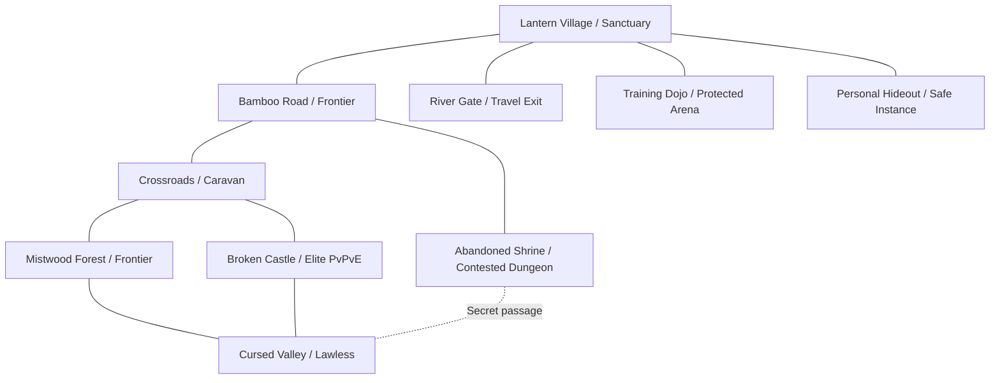

# Samurai Assassin — Environment, World & Level Design

> **Status:** Design proposal; the **P0 greybox slice (§13) is implemented**: see "Implementation status" below.  
> **Visual direction:** Dark-fantasy Edo-inspired Japan (fictional setting; supernatural elements clearly marked).  
> **Related:** [GDD.md](GDD.md), [GUI.md](GUI.md), [3DMODELS.md](3DMODELS.md), [MULTIPLAYER.md](MULTIPLAYER.md).

## Implementation status (P0 greybox slice)

| Item (§13 P0) | State | Where |
|---|---|---|
| Village hub (sanctuary) | Lantern Village: two rows of Shirakawa-go gassho farmhouses, stone lanterns, cherry and maple trees, well square, pagoda landmark (Sketchfab CC BY models) | `scripts/world/province_level.gd` |
| Dojo | Courtyard duel ring (protected arena) with an open-sided shrine hall, tsuiji-bei walls (posts, tile cap), katana rack, stone lanterns | same |
| Danger crossing + return gate | Torii approach (sanctuary buffer), authored boundary torii, lit return waystone; rules announced by the HUD title card, not floating text | same |
| Bamboo combat clearing | Procedural bamboo grove (MultiMesh stalks + leaf cards, real clump colliders), open duel clearing with rim cover, mist volume | `scripts/world/world_kit.gd` |
| Small ruin | Broken walls, pillars, fallen torii, rubble, cyan "ghost residue" light | same |
| Region rules (§1.3) | Server-authoritative `ZoneRule` from `RegionMap`, replicated per fighter; no hostile damage in sanctuaries | `scripts/core/zone_rule.gd`, `scripts/world/region_map.gd` |
| Region transitions | Signage + HUD region pill + pre-entry warning + banner/stinger; rule flag comes from the server | HUD (`combat_hud.gd`) |
| Basic ambience | Golden-hour HDRI sky + IBL, AgX grading, volumetric haze, warm lanterns, crickets, footsteps by surface | `province_level.gd`, `sfx.gd` |
| Terrain & foliage | Terrain3D (MIT) hills beyond the walls, painted forest floor, instanced grass, ~1,900-tree pine forest (LOD1 near, LOD2 mid, billboards far, per-96 m chunk MultiMeshes); distant castle on the ridge; playable area kept flat | `province_terrain.gd` |
| PvE camps | Bandits at the clearing and ruin, server-driven, leashed, never enter sanctuaries | `npc_director.gd` |
| Optimization (§10) | Static batching per material per 32 m cell, box occluders, chunked MultiMeshes with visibility ranges | `static_batcher.gd`, `world_kit.gd` |
| Loot remains | **Not built**: needs inventory (P2) | — |

Buildings, trees and lanterns are CC BY 4.0 Sketchfab models reduced by `tools/optimize_models.gd` (WebP textures, bounds manifest) and placed at real-world scale by `scripts/world/asset_kit.gd`; kit materials are CC0 Poly Haven PBR sets. Authors in `assets/third_party/CREDITS.md`. Measured on an M2 at 1600×900 High: about 30–35 fps in the village, 1.1–1.8 M primitives.

## 0. Vision and invariants

The environment is not a background: it creates the choices to hide, ambush, duel, cooperate, extract, navigate, gather, hunt bosses and discover hidden techniques. Build a dense, readable world first—not a huge empty seamless landscape.

**Game rules reflected in geography:** a visibly safe sanctuary, clear transition to dangerous shared PvPvE regions, contestable dungeons and private PvE instances with published entry rules. When a player dies in dangerous regions, unsecured carried loot is dropped; equipped weapons/gear, socketed gems, learned techniques, mastery and cosmetics are protected. Level art, signage, lighting and gates must convey these stakes.

**Key experience goals:** 1) memorable destinations; 2) distinctive silhouette/lighting for navigation; 3) fair melee collision and camera angles; 4) tension from risk/return decisions; 5) secrets found through observation; 6) attractive screenshots without hiding combat cues; 7) feasible performance for multiplayer.

## 1. World topology and region design

### 1.1 Proposed first region: The Shrouded Province



| Region | Risk | Encounter design | Primary resources / discoveries | Look |
|---|---|---|---|---|
| Lantern Village | Sanctuary | Vendors, training, trade, staging, social | Stash, forge, workshop, bulletin | Paper lanterns, rain-dark wood, market streets |
| Training Dojo | Protected duel | Timing tutorials, skill mastery | Technique hints, duel mastery | Straw floors, sliding doors, practice courtyard |
| Bamboo Road | Frontier | Patrols, ambushes, early PvP | Wood, plants, starter materials | Tall bamboo, wind, light fog |
| Crossroads | Frontier | Caravan, escorts, faction patrols | Scroll supplies, trade routes | Bridges, cart trails, waystones |
| Mistwood Forest | Frontier | Stealth enemies, trackers, miniboss | Herbs, gem fragments, secret teacher | Layered tree trunks, wet leaves, moon shafts |
| Abandoned Shrine | Explicit private/contested variants | Puzzle, rare scroll, boss | Technique fragments, unique gems | Broken torii, stone lanterns, spirit growth |
| Broken Castle | Contested high risk | Indoor melee, vertical routes, group fight | Rare forge components, elite arms | Collapsed walls, fires, armor displays |
| Cursed Valley | Lawless | Elite mobs, open PvP, rotating event | Rare gems, spirit clues | Red mist, black rock, twisted roots |
| River Gate | Rule-specific travel gate | Escape/transfer/choke decision | Waystones, contracts | River, bridge, watchtowers |
| Hideout | Safe/private | Inventory, display, wardrobe | Permanence, memories | Small personal wood-and-paper interior |

**Layout rules:** Each critical junction has 2+ navigable approaches where feasible; some high-value objectives have deliberate choke points signaled well before entry. Offer retreats, cover, mixed elevations and flank routes. No forced spawn-kill corridors. Safe entrances have no combat or loot claim exploitation within a guarded buffer.

### 1.2 Region scale and pacing (targets requiring playtest)
- Starter loop: village → beginner threat → village, approximately 5–12 minutes.
- Regular expedition: 15–35 minutes; deeper run 30–60 minutes.
- Landmark visible every 30–90 seconds of travel in major routes; avoid vast repetitive forests.
- 2–4 distinct approaches to each flagship high-value encounter; preserve both stealth and visible roads.
- Travel should create decisions: direct dangerous road versus slow concealed footpath; bag burden increases return pressure without extreme PvP penalties.

### 1.3 World-state taxonomy
- `SAFE_SANCTUARY`: no hostile damage, free legal equipment/gem changes, banking.
- `FRONTIER_PVP`: PvP allowed under displayed rules; unsecured carried loot drops on defeat.
- `LAWLESS_PVP`: open PvP and higher risk/reward **but same current carried-loot death rule**; do not invent full gear loss here.
- `PRIVATE_PVE_DUNGEON`: protected from other parties; published defeat/loot behavior per instance, default risk explicitly disclosed.
- `CONTESTED_DUNGEON`: multiple players/parties may enter, PvP permitted if announced before entry, loot drops governed by carried inventory rule.
- `ARENA_PROTECTED`: consent duels and standardized match mode; no carried-loot loss.
- `HIDEOUT_PRIVATE`: safe social/display environment.

Each region transition must have signage, minimap legend, audio stinger, UI warning, and authoritative region flag (see MULTIPLAYER.md). Visual appearance alone cannot determine the rules.

## 2. Environment art direction

**Period influence:** Edo streets, tiled/thatched roofs, wooden framing, shoji/fusuma motifs, torii and shrines, armor displays, paper lanterns, castle walls, garden bridges, rivers, bamboo groves. Blend with fictional cursed architecture, spectral marks and Oni corruption; do not label invented supernatural beliefs as real history.

**Mood:** dramatic silhouettes, selective moonlight, restrained red-violet supernatural accents, warm safe havens versus desaturated danger. Keep player outlines readable even in fog/night/rain.

**Material language:** weathered wood, stone, plaster, tile, thatch, lacquer, steel, silk/cloth, moss, bark, paper, iron, ceramic, ash. Use authored variation so modular pieces do not repeat obviously.

**Color and lighting geography:**
- Sanctuary: amber lanterns, gentle interiors, warm market and quiet blue twilight exteriors.
- Frontier: bamboo green, cool mist, interrupted warm highlights.
- Ruins: slate, wet stone, cyan-white ghost residue, selective blood-red accents.
- Lawless: darker terrain and cursed red/purple landmarks; **do not** lower overall visibility enough to confer combat advantage to graphics settings.
- Boss arena: clear perimeter, uncluttered floor and contrasted telegraphs; environmental storytelling sits outside essential collision paths.

## 3. Environment kit and asset families

| Kit | Modular asset examples | Variants and gameplay considerations |
|---|---|---|
| Village housing | Timber bay, door, window, wall, roof, veranda, stair, shutters | Corner/straight/end pieces, collision consistency, window occlusion |
| Shops/workshops | Forge, anvil, gem bench, scroll table, medicine shop, hanging signs | Interactive sockets, vendor marker readability |
| Shrine | Torii, steps, altars, stone lanterns, prayer ropes, paper charms, bells | Secret clue channels; interactive/destroyed states |
| Castle | Stone foundation, retaining wall, gate, tower, parapet, stairs, rubble | Footstep/nav clearance, camera obstruction |
| Bamboo/forest | Trunks, bamboo groups, branches, bushes, rocks, roots, fallen trees | Occlusion, stealth cover, density LOD, no invisible blockers |
| Mountain/valley | Cliff chunks, ledges, caves, ridges, streambed, bridges | Traversal boundaries, authoritative combat collision |
| Caves/dungeons | Wall/floor/ceiling modules, arches, gates, slabs, columns, traps | Grid metrics, reusable room connectors, sightlines |
| Roads/props | Waystones, carts, rope barriers, fences, crates, banners, lamps | Climb/block rules, destructibility policy |
| Interactive | Chests, gathering nodes, gates, levers, pressure plates, loot remains | Clearly defined server-owned state and interaction range |
| Atmosphere | Mist volumes, leaves, fireflies, falling ash, light rain, waterfalls | Non-obscuring PvP cues, quality tiers |

Every kit needs: pivot rules, dimensions, UV/material sets, LOD/collision, lightmap/GI compatibility as chosen, navigability, state variants, and impact on network-visible gameplay.

## 4. Traversal, parkour and camera

**Base traversal proposal:** third-person walk/run/sprint, jump, dodge; simple mantle/climb optional and deferred until verified stable online. No free wall-running initially. Weapon weight influences combat reach/timing; carried loot affects travel burden without severe duel penalties.

**Level rules:**
- Mark vaultable, non-vaultable, climbable and blocked surfaces consistently, with materials/geometry that communicate the action.
- Avoid tiny terrain irregularities that interrupt sword combos or cause physics jitter.
- Combat spaces require sufficient clearance for Nodachi wide swings; tight interiors can deliberately favor Wakizashi, but must not cause unavoidable camera clipping.
- Every concealed path has a readable visual language (lantern color, carved mark, breakable brush, unusual sound), not random pixel hunting.
- Prevent rooftop/world-geometry exploits: visible boundaries, authoritative navigation, no unsafe holes, safe fallback respawn points.
- Falling damage and swimming are **TBD**. Do not assume either is available without design acceptance.

## 5. Level design patterns for PvPvE

### Combat spaces
1. **Duel clearing:** circular/elliptical open zone, limited obstructions, known exits; ideal for parry/stance fights.
2. **Bamboo ambush path:** parallel flanking route, sight-breaking bamboo, staggered cover; no permanent invisibility exploit.
3. **Bridge crossing:** risk/reward shortcut with readable alternative route; no unavoidable infinite knock-off loop.
4. **Courtyard boss arena:** strong silhouette, phase geometry changes only with server-visible telegraphs.
5. **Shrine puzzle hall:** clues and symbols decipherable without a language requirement or inaccessible color differences.
6. **Castle siege route:** vertical sightlines and multiple levels, but bounded for third-person camera and melee hit registration.
7. **Extraction approach:** exposed return path plus optional longer stealth approach; protected safe-buffer on completion.

### Fairness checks
- Attack and danger telegraphs never visually blend into floor materials.
- Foliage occlusion must match visibility/stealth rules consistently across graphics presets; no unfair “low setting removes all cover”.
- Thin geometry must not allow weapons to hit through solid walls unless explicitly authored as an attack property.
- Boss collision and arena hazards deterministic to spectators/participants; avoid random unavoidable damage.
- Avoid spawn points within immediate line of fire/attack from a hostile player.

## 6. Dungeons, bosses and special locations

| Dungeon type | Entry rules | Design shape | Gameplay distinguishing feature |
|---|---|---|---|
| Hidden Master Trial | Solo/party as authored, clear loss policy | Compact dojo/shrine | Timing and stance mastery; skill clue |
| Buried Shrine | Private PvE or contested selectable mode | 4–8 authored rooms | Puzzle, ambush, technique scroll |
| Broken Castle Depths | Contested PvPvE | Connected wings/courtyards | Boss plus rival parties, extraction decision |
| Spirit Cavern | Rare scheduled or discovered | Short multi-stage cave | Spirit weapon trial, environmental changes |
| Oni Lair | Boss raid instance/shared event | Large arena with side lanes | Readable multi-phase boss mechanics |

**Example boss encounter — The Bell Keeper (illustrative):** first phase slow Nodachi telegraphs; second phase bell changes floor hazard rhythm; third phase summons specters that can be countered with disciplined parries. The room provides auditory/visual beat cues, safe reset points and multiple difficulty states; boss action is server-authoritative.

**Puzzle ethics:** clues should reward attention; no mandatory real-money hints or unpredictable one-time failure that permanently locks progression. Limited-holder technique acquisition must follow documented succession/availability rules.

## 7. World events and systemic content

- **Oni Incursion:** corrupted temple emergence, open-world PvPvE objective, boss and contested recovery.
- **Celestial Fracture:** visible fallen crystal, several approaches, rare gem fragments, extractable unsecured loot.
- **Caravan Run:** escort/ambush/counter-bounty with jurisdiction and friendly-fire rules.
- **Master's Challenge:** roaming/scheduled swordmaster, possible secret technique clue, controlled duel zone.
- **Cursed Fog:** limited regional visibility and changed monster patrols; must maintain competitive visibility.
- **Assassin Echo:** rare notable duel leaves temporary spectral memorial; opt-out/privacy and performance cap.
- **Shrine Reawakening:** regional puzzles change after a server-authoritative milestone.

**Event UX/state:** preparation hint → announced active region → in-world landmark/sound → objective participation → deterministic reward eligibility → cleanup and cooldown. Events must not permanently block main routes or safe returns. Event persistence after restarts/region transfers needs explicit server behavior.

## 8. Nature, ambience and environmental storytelling

**Biomes:** bamboo forest, cedar woodland, river delta, mountain shrine, rainy village, ruined castle, cursed basin. Target distinct surface audio, leaf/snow/rain VFX as applicable, landmark silhouette and gameplay resources for each.

**Dynamic time/weather (proposal):** controlled day/night and presets: clear, mist, drizzle, rain, storm, rare supernatural eclipse. Weather is synchronized sufficiently for fairness: critical visibility/stealth changes authored by server state, while decorative droplet particle distribution can remain client-local. Do not tie PvP stealth solely to client fog fidelity.

**Environmental stories:** broken blade in shrine, abandoned caravan, previous owner's inscription, spectral battle residue, hidden master training marks, faction graffiti. Use collectible clues sparingly; exploration should reward observation rather than UI spam.

**Soundscapes:** bamboo creaks, distant bells, cloth and armor movement, rivers, birds and insects in sanctuary; ominous silence and shifted reverb in cursed areas. Spatial audio should help awareness without revealing deliberately hidden players beyond game rules.

## 9. Gathering, loot, interaction and routes

Resource nodes: bamboo/wood, herbs, ore, shrine relics, gem deposits, spirit traces. Each node has appearance (fresh/harvested/depleted), interact radius, respawn rules, ownership/contest rules, rarity and audio cue. Important high-value nodes should be located on contested routes, not directly adjacent to sanctuary boundary.

Loot can appear in chests, boss rewards, quest caches, death remains and world drops. Each has distinct model, rarity treatment and interaction prompt; **world art never grants loot by itself**. Server confirms entitlement, amount, ownership transfer and removal. Loot bags/corpse markers must not expose protected equipment as lootable.

Safe return methods: physically crossing sanctuary border and optional authored gates/evacuation interactions. Fast banking from danger is forbidden by current design. When loot burden grows, world topology should make the choice to push on versus return visibly understandable.

## 10. Optimization and multiplayer-safe environment design

- Chunk world by region/streaming cell; client streams decorative visuals, server simulates authoritative walkable/collision/gameplay scene state.
- Fixed bounds/portals for instanced dungeons; shared zones replicated by interest management.
- Use instancing/`MultiMeshInstance3D` where suitable for repeated non-interactive detail; do not accidentally treat network-owned destructibles as static decoration.
- Author LOD/HLOD/impostors for distant houses, dense trees and cliffs. Foliage and particles use density caps and scalable quality tiers.
- Occlusion culling and visibility ranges tested per level; light/shadow settings benchmarked on the minimum target hardware (**not yet decided**).
- Collision meshes: simplified primitives for most environmental props, separate visual meshes; high precision only where combat requires.
- Navigation: character-scale clearance, dynamic blocker rules, fallback on blocked routes, no authoritative path decisions from client.
- Dynamic props and destruction: only for objects with meaningful gameplay; avoid large numbers of networked rigid bodies.
- Network state payload for events/doors/nodes: compact IDs + states, not full scene trees; stable content identifiers.
- Performance budgets (e.g., draw calls, ms/frame, triangle counts, NPC density, particle numbers) must be profiled and approved after deciding target hardware and player density, not invented as guaranteed values.

## 11. Environment pipeline: Godot-friendly authoring

1. Greybox routes and encounter spaces at real character scale; validate camera, hitboxes, sprint and escape before art.
2. Establish kit grid, door/frame dimensions, collision and snap points. Prefer glTF 2.0 asset import and clear reimport rules.
3. Build modular biome kits and hero landmark scenes; keep decorative mesh files independent from gameplay descriptors.
4. Bake or generate navigation data under documented settings; decide dynamic crowd interaction separately.
5. Tag interactables with stable content IDs and server-authored spawn descriptors; no direct loot logic in VFX props.
6. Profile lighting, shaders, foliage, weather and 2–80 simulated characters before locking visual density.
7. Validate day/night, all video presets, camera angles, controller navigation and accessibility under combat effects.
8. Add landmarks and lore clues only after movement/combat sightlines pass testing.

**Suggested Godot content tree**
```text
res://world/
  regions/shrouded_province/
    lantern_village/
    bamboo_road/
    crossroads/
    mistwood/
    abandoned_shrine/
    broken_castle/
    cursed_valley/
  dungeons/{buried_shrine,oni_lair,spirit_cavern}/
  kits/{village,shrine,castle,cave,nature}/
  props/{interactive,decorative,gathering}/
  terrain/  navigation/  lighting/  weather/  ambient_audio/
  encounters/  spawn_points/  landmarks/  events/
```

## 12. Environmental QA matrix

| Scenario | Acceptance |
|---|---|
| Safe → dangerous | Visible warning, readable terrain landmark, correct server rule flag |
| Dangerous → safe | No instant loot protection before server confirms crossing |
| Duel at low graphics | Target, attacks, cover and telegraphs remain as readable as higher presets |
| Nodachi in castle | Collision/camera do not cause invisible hit or unplayable camera |
| Large party at boss | Encounter, FX and collision remain legible, scalable performance |
| Storm/weather sync | Gameplay-affecting visibility/hazards consistent among clients |
| Scarf and foliage | Fabric does not hide major hitboxes or cause geometry exploits |
| Disconnect near gate | Server owns position/zone state; reconnect never grants false extraction |
| Gather simultaneously | Exactly one or properly apportioned authoritative result |
| Boss arena reset | No permanent trapped players or uncleared blockers |
| Event despawn/restart | No ghost nodes or duplicate rewards |
| Spectator/photomode | No see-through-enemy advantage in PvP |

## 13. Stage gates and asset priority

**P0 greybox:** village hub, dojo, one danger crossing, bamboo combat clearing, small ruin, return gate, loot remains and basic ambience. Multiplayer melee visibility/authority passes before artistic expansion.

**P1 alpha:** complete first-region loop, shrines, castle approach, basic dungeon, gathering, varied lighting and weather, event landmark, navigation and environment optimization.

**P2:** cursed valley hero biome, contested dungeon, advanced boss arena, world events, environmental history, hideout/interiors, landmark shaders and storytelling. **P3:** new provinces/biomes only if density, retention and performance justify them.

## 14. Decisions not finalized

- Exact first-region dimensions, dungeon count, travel speed and player density per region.
- Whether open-world weather/night has authoritative combat modifiers or is visual only.
- Whether swimming, climbing, rope traversal, mounts or environmental destruction belong in a later update.
- PvP jurisdiction details, clan territory mechanics, safe gateway buffers and dungeon loot rules.
- Art style final stylization level, minimum PC GPU and lighting/rendering feature set (Forward+/Mobile/Compatibility).
- Whether cross-server travel is offered at launch; never promise seamless shared-world transitions.

---
**Document owner:** World Design / Environment Art. Keep each risk boundary, spawn, traversal rule and interactive object aligned with GDD death semantics, multiplayer authority and corresponding GUI notifications.
