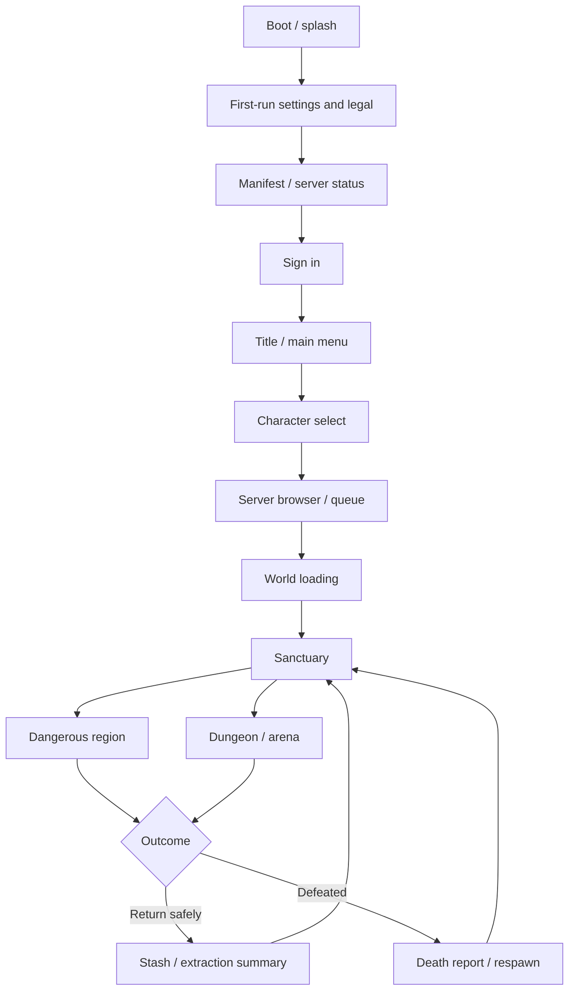

# Samurai Assassin — Complete GUI / UX Specification

> **Status:** Product design specification; **P0 screens that have backing systems are implemented**: see "Implementation status".  
> **Engine:** Godot 4.x, GDScript. **Backend:** Go for account/session/economy endpoints; Godot headless for real-time authority.  
> **Companion docs:** [GDD.md](GDD.md), [ARCHITECTURE.md](ARCHITECTURE.md), [MULTIPLAYER.md](MULTIPLAYER.md), [ENVIRONMENT.md](ENVIRONMENT.md), [3DMODELS.md](3DMODELS.md).

## Implementation status (P0)

Implemented (`scripts/ui/`, HUD in `scripts/presentation/combat_hud.gd`): design tokens + global theme (§3);
BOOT-01/02 splash, BOOT-03 first-run accessibility, BOOT-06/LOAD-04 connection errors with retry, AUTH-01 as an
honest local name stub, HOME-01 title menu over the live village, HOME-07 saved-server list, HOME-10/LOAD-01 real
join phases, GAME-01 vitals with delayed damage + action bar, GAME-02 compass/region pill/latency, GAME-03 target
panel, GAME-06 danger-boundary warning, GAME-30 controls card, GAME-34 defeat report, MENU-01 pause (non-pausing
online), MENU-02 settings (video/audio/gameplay/accessibility/network, saved per device, display-mode revert
countdown), MENU-03 remapping with conflict warnings, MENU-07 credits from the asset manifest; quality presets,
FSR 1/2 / MetalFX upscaling, TAA, SSIL/SDFGI. HOME-01 is now a 3D showcase stage with the player's own samurai
(drag to turn), META-02 Armory with live preview, and SHOP-01/02/03 Store with try-on and confirm dialog (demo
wallet, clearly labelled; real purchases need server-verified receipts).

Art direction (ink, washi and gold): Cormorant Garamond display serif, Inter body, Yuji Boku brush
calligraphy; 9-slice washi panels, sumi brush-swipe hovers, brush-stroke vitals, gold ornament rules,
game-icons.net glyphs (CC BY 3.0); lacquer item cards with rarity strips; screen-blur behind in-game
menus, vignette over the menu stage; HUD edge scrims and text shadows for daylight legibility; zone
title cards and a full-screen brush defeat screen. Textures baked by `tools/bake_ui_textures.gd`.
Store and Armory list garb dyes, enchanted blades (embers, frost, lightning, spirit, fire) and premium
silk scarves (gradient, seigaiha, starfield, glowing tips, tip particles); detail panels list each item's effects.
Video settings add "Image enhancement" (PostFx) and a sharpening slider.

**Not built, waiting on systems:** GAME-07/08/09/14/15/33 (inventory, equipment, six-skill loadout, loot, stash,
extraction need P2 inventory/persistence), GAME-29 dialogue (no NPCs), LOAD-03 resume (no session resume in P1),
HOME-08 queue, ping/population in the server list (server directory is P4), localization beyond English.

## 0. Product and interface principles

**Fantasy:** A refined, dark-fantasy Edo-era assassin experience. UI evokes ink, washi paper, lacquer, bronze, and moonlight; combat remains legible, modern, and responsive. **Do not** sacrifice readability to decorative Japanese calligraphy.

**Committed design decisions**
- Third-person 3D PvPvE battleground with sanctuary hubs, dangerous shared zones, optional safe/contested dungeons and arenas.
- Six freely configurable equipped ability slots **plus** universal light/heavy attack, guard/parry, dodge, sprint, jump and stance controls.
- Learned skills/mastery, active equipped equipment, socketed gems and cosmetics are protected on death. **Unsecured carried inventory drops** on defeat in dangerous zones. Unlearned skill scrolls in the carried bag are at risk.
- Gems can be removed/swapped **without a currency or material fee**, but loadout/equipment changes are restricted to sanctuaries or designated safe staging points; never allow mid-fight protection exploits.
- Rare spirit weapons, unique/limited-holder/legacy techniques, buff scrolls, weapon mastery, resonances and Technique Weaving need visible, understandable interface support.
- Monetization model, storefront payments, age rating, platform and input devices are **proposals/TBD**. No paid gameplay power is assumed.

**Core UI principles:** gameplay-first HUD; clear danger warnings; no ambiguous loss state; controller + keyboard/mouse navigation; accessibility from boot; consistent confirmation and pending states; clear separation of client previews and server-confirmed results. All inventory, death, unique-technique ownership, matchmaking, economy and loot operations must show authoritative results.

## 1. Information architecture / exhaustive screen map

Screen IDs are stable reference keys. `P0` = playable multiplayer vertical slice; `P1` = closed alpha; `P2` = expanded release; `P3` = optional/late. Screens may be overlays, pages, or 3D world interactions; each still requires explicit UX specification.

| Screen ID | Screen / state | Stage | Core content / actions |
|---|---|---|---|
| BOOT-01 | Studio/publisher splash | P0 | Short, skippable once allowed; epilepsy warning if required |
| BOOT-02 | Engine/game splash | P0 | Game mark + reduced motion variant |
| BOOT-03 | Language / accessibility first run | P0 | Language, subtitles, contrast, photosensitivity, text scaling |
| BOOT-04 | Legal / privacy / EULA | P1 | Consent/version, age-related gates where required |
| BOOT-05 | Loading / patch validation | P0 | Build/content manifest, download progress, integrity problems |
| BOOT-06 | Connectivity / service status | P0 | Reachability, version mismatch, maintenance and retry |
| AUTH-01 | Sign in | P0 | Credentials, remember device/session, error feedback |
| AUTH-02 | Create account | P1 | Registration and terms |
| AUTH-03 | Verify email | P1 | Code/link status, resend cooldown |
| AUTH-04 | Forgot/reset password | P1 | Request/reset confirmation and expiry |
| AUTH-05 | Device/session security | P1 | Session revoke, reauth, account linking as supported |
| AUTH-06 | Account restriction / appeal | P1 | Reason category, expiration, support route, no sensitive details |
| HOME-01 | Title / main menu | P0 | Play, Assassin, Loadout, Store (P2), Settings, Credits, Quit |
| HOME-02 | News / event bulletin | P1 | Event dates, maintenance, updates, featured challenges |
| HOME-03 | Profile / account | P1 | Account name, region, social privacy, safety |
| HOME-04 | Character selection | P1 | Slots, last region, character status, create/select/delete |
| HOME-05 | Character creation | P1 | Body, face, hair, skin tones, starter apparel, voice/identity choices |
| HOME-06 | Character deletion/restore | P1 | Strong warning, cooldown/verification, policy TBD |
| HOME-07 | Server/region browser | P0 | Ping estimate, capacity, rules, maintenance, population, queue |
| HOME-08 | Queue / admission | P0 | Place, progress estimate only when reliable, cancel |
| HOME-09 | Party lobby | P1 | Invites, roster, ready status, chat, server selection |
| HOME-10 | Join / character handoff | P0 | Authorization and transition to world, retry/cancel |
| LOAD-01 | Fullscreen loading / travel | P0 | Region name, legal/tips, loading phase and failure recovery |
| LOAD-02 | Dungeon instance loading | P1 | Dungeon risk type, party summary, boss hint, cancel rules |
| LOAD-03 | Reconnect / restoring state | P0 | Session resume, grace window state, non-authoritative countdown warning |
| LOAD-04 | Lost connection / kicked | P0 | Reason, reconnect, go to menu, support code |
| GAME-01 | Combat HUD | P0 | HP, stamina, posture, spirit, skills, cooldowns, status effects, crosshair/target |
| GAME-02 | Exploration HUD | P0 | Compass, risk region, objective, interaction prompts, loot burden |
| GAME-03 | Target / enemy HUD | P0 | HP, posture, cast tells, hostile/friendly alignment |
| GAME-04 | Boss HUD | P1 | Name, phase, posture/health, marked arena danger/telegraph |
| GAME-05 | PvP duel state | P1 | Consent/rules, rival, start/end, protection indicators |
| GAME-06 | Danger boundary warning | P0 | Explicit carried-loot loss notice before entry |
| GAME-07 | Inventory / backpack | P0 | Secured vs equipped vs carried, weight, stack split, inspect |
| GAME-08 | Equipment / paper doll | P0 | Weapon, armor, scarf, cosmetic slots, gem sockets, loadout lock |
| GAME-09 | Six-skill loadout editor | P0 | Slots, categories, compatibility, saved presets, lock state |
| GAME-10 | Technique codex / skill library | P1 | Known/unknown/rumored arts, mastery, upgrade paths, lineage |
| GAME-11 | Weapon mastery / stances | P1 | Progression, unlocked stances, training tasks |
| GAME-12 | Gem socket / resonance workshop | P1 | Drag/drop, active resonance preview, conflict rules |
| GAME-13 | Buff scrolls / consumables | P1 | Consume, category stacking, remaining duration, danger status |
| GAME-14 | Loot window / remains | P0 | Eligible items, contested pickup, server-pending claim |
| GAME-15 | Secure stash / banking | P0 | Deposit, withdrawal, sorted containers, transaction result |
| GAME-16 | Crafting / forging / fusion | P1 | Recipe, ingredients, result, irreversible consume confirmation |
| GAME-17 | Vendor / NPC trade | P1 | Buy/sell, currency, capacity, server receipt |
| GAME-18 | Player-to-player trade | P2 | Escrow, lock, review, signed commit, cancellation |
| GAME-19 | Marketplace / auction board | P2 | Browse, sell, taxes/fees, history, anti-fraud notices |
| GAME-20 | World map / region map | P1 | Safe/risk boundaries, landmarks, optional player party pins |
| GAME-21 | Mini-map / compass controls | P1 | Zoom/rotation, fog of war, privacy limits |
| GAME-22 | Quest / contract journal | P1 | Bounties, PvE contracts, hidden clues, abandon/track |
| GAME-23 | Assassin Chronicle | P2 | Notable duels, discoveries, clan history, consent/privacy |
| GAME-24 | Bounty / notoriety board | P2 | Targets, rewards, eligibility, self-defense rules |
| GAME-25 | Party panel | P1 | Health, invites, leader, revive/loot agreements if enabled |
| GAME-26 | Clans / alliances | P2 | Roster, ranks, permissions, emblems, recruitment |
| GAME-27 | Chat / emotes / voice controls | P1 | Local/party/clan, mute/block/report, accessible text |
| GAME-28 | Social contacts | P1 | Friends, invites, recent players, privacy, block |
| GAME-29 | Interact / dialogue | P0 | NPC lines, choice prompts, skip, subtitles, quest/merchant links |
| GAME-30 | Tutorial / training dojo | P0 | Movement, parry, posture, skills, death/loot education |
| GAME-31 | Dungeon / boss mechanics panel | P1 | Objectives, puzzle inventory, party roles, phase hints |
| GAME-32 | World event alert / tracker | P1 | Start/end, site, PvP designation, relevant rewards |
| GAME-33 | Extraction / gate / return | P0 | Secure-zone destination, cast/interruption, risk warning |
| GAME-34 | Death / defeat report | P0 | Cause, killer/environment, dropped inventory, respawn |
| GAME-35 | Loot recovery / corpse map | P1 | Remaining claim window if supported; no guaranteed retrieval |
| GAME-36 | Arena match summary / scoreboard | P2 | Combat outcomes, stats, rewards, conduct report |
| GAME-37 | Hideout | P2 | Interactive stash/armory/chronicle/presets display |
| GAME-38 | Spirit weapon bond/history | P2 | Temperament, awakenings, owners, lore, no exposed private data |
| GAME-39 | Rare technique discovery / ritual | P2 | Clues, requirements, incumbent/holder rules, confirmation |
| GAME-40 | Photo mode | P2 | Free camera limits, hide UI, privacy/PvP exploit restrictions |
| MENU-01 | Pause / system menu | P0 | Resume, settings, controls, accessibility, support, exit |
| MENU-02 | Settings (all categories) | P0 | Video, audio, gameplay, controls, network, accessibility, privacy |
| MENU-03 | Input remapping | P0 | Keyboard/mouse/controller, conflicts, reset, glyphs |
| MENU-04 | Help / glossary / codex | P1 | Basic terms and gameplay explanations |
| MENU-05 | Report / block player | P1 | Category, recent encounter IDs, server reference, submit |
| MENU-06 | Support / diagnostics | P1 | Build, region, connection diagnostics, safe bug report |
| MENU-07 | Credits / acknowledgements | P1 | Studio, contributors, attributions, licenses |
| SHOP-01 | Cosmetic store landing | P2 | Featured looks, categories, owned state, preview |
| SHOP-02 | Item details / 3D try-on | P2 | Rotatable preview, scarf simulation, compatibility |
| SHOP-03 | Cart / checkout | P2 | Pricing, currency, terms, confirmation and pending receipt |
| SHOP-04 | Purchase history / entitlements | P2 | Owned cosmetics, restore, receipts and refunds entry point |
| SHOP-05 | Redeem / reward claim | P2 | Codes/rewards, expiration, anti-abuse |
| META-01 | Achievements / titles / seasonal rewards | P2 | Earned, locked, conditions, claim status |
| META-02 | Personalization / wardrobe | P1 | Skins, dyes, masks, armor, scarf, trails, execution cosmetics |
| META-03 | Notifications / inbox | P2 | System messages, invitations, compensation, claim receipts |
| META-04 | Patch notes / known issues | P1 | Version, key changes, link to full notes |
| META-05 | Session results / extraction summary | P1 | Secured loot, lost items, mastery progress, highlights |

## 2. Screen flow and navigation rules



- Global back behavior: pop overlay → close modal → previous page. Never let Escape accidentally discard an active economic operation; warn about pending state.
- Page transitions: 150–300ms default conceptual budget, reduced motion disables ornamental animations; never block gameplay input while a purely cosmetic transition plays.
- Fullscreen overlays permitted only in safe areas (loadout, stash, forging, shop) except inventory inspection where rules allow. Dangerous area inventory opens a non-pausing, compact panel; the world continues.
- HUD, overlay, modal, toast, network notification and critical warning are independent layers with a stable priority policy.
- Support ultrawide aspect ratios, 16:9, 16:10, safe-area margins and resolution scaling. Mouse pointer captured in gameplay, released in menus.

## 3. Branding, visual language and design tokens

**Visual direction:** elegant dark lacquer backgrounds; deep charcoal; warm off-white text; muted red for danger; gold for mastery/rarity; blue-violet for spirit; green for safe zones. Use color only as secondary reinforcement; icons/text communicate meaning.

| Token | Proposed example | Use |
|---|---|---|
| `surface/base` | `#111315` | Main panels and menus |
| `surface/raised` | `#1C2023` | Cards, tooltip surface |
| `surface/paper` | `#D8CFBD` | In-world scroll/paper motif, sparingly |
| `text/primary` | `#F2EEE6` | High contrast text |
| `text/secondary` | `#B6B4AE` | Metadata |
| `accent/vermillion` | `#C94F43` | Danger, combat urgency |
| `accent/gold` | `#D7AE61` | Mastery / selected focus |
| `accent/spirit` | `#9883CF` | Spirit / supernatural |
| `status/safe` | `#6DA987` | Safety |

- Primary typeface: highly legible UI sans; stylized display face restricted to headings, logos and title art. Verify commercial license and language support.
- Spacing scale: 4/8/12/16/24/32 px at reference density; 44×44 px minimum interactive target on controller-oriented menus as a target.
- UI iconography: consistent silhouette and semantic shape; sword, dagger, shield, eye, pouch, gem, scroll, spirit, skull, crossed blades, seal, waypoint, lock.
- Rarity must be shown via text + border + symbol, **not color alone**. Rare cosmetic appearance must not disguise hostile attack tells.
- Effects layering: background illustration < dimmed scene < gameplay text < high priority combat readability indicators < emergency modal. Boss attacks must not be covered by decorative toasts.

## 4. HUD: exact widgets, interactions, edge cases

### 4.1 Player HUD
- Upper-left player vitals: health bar with delayed damage segment, stamina bar, posture meter, Spirit gauge. Low-health alert configurable and never flashing excessively.
- Bottom-center **six** skill slots: icon, input glyph, cooldown radial, charges, available Spirit, disabled reason, activation windup. Distinguish unlearned, unequipped, locked-by-region, on-cooldown, and insufficient-resource states.
- Lower edge utility: 1–3 quick-access consumable bindings (number TBD), equipped weapon name, stance icon, next available scroll buff, active buff category cap.
- Threat/target widget: health and posture, hostile/friendly/duel badge, ability cast progress, lock-on indicator. Never expose enemy secret inventory, gem identities, or technique ownership without explicit reveal gameplay.
- Compass/region label: sanctuary/frontier/lawless, PvP flag, distance to safe return, group markers; mini-map optional and not guaranteed to reveal stealth players.
- Status effects: max visible icons, severity sorting, duration indicators, expandable list; cleanseable vs non-cleanseable displayed.
- Pickup ticker: item, rarity, quantity and whether **CARRIED / AT RISK**; clear server-confirmation marker.
- Loot burden: unobtrusive until thresholds reached, then a clear travel impact notice.
- Connection indicator: ping, packet loss/quality when poor; never promise authoritative latency from client clock alone.

### 4.2 PvP / combat overlays
- Incoming attacks: animation/VFX/audio are primary tells; optional accessibility assistance cannot reveal hidden enemies.
- Perfect parry: concise feedback, posture impact, subtle camera/audio cue; no excessive shake.
- Technique Weaving: when a valid interaction occurs, small emblem and unique but readable effect. Discovery presentation appears **after** immediate danger, not during a lethal exchange.
- Executions: short cinematic/finisher with target-controlled visibility, strict authoritative state and no concealment of third-party threats.
- PvP target identification: player name privacy settings, faction/party marker, bounty marker only when server-authorized.
- Safe-zone crossing: pre-entry modal once per session per rule revision and persistent border/risk HUD. Example: **“Dangerous area: unsecured backpack items drop on defeat. Equipped gear and learned skills are protected.”**

### 4.3 Loot and death clarity
- Inventory tabs **Equipped & Protected**, **Carried & At Risk**, **Secured Stash** (only accessible at valid locations).
- Death overlay shows precisely the categories affected; server receipt identifies dropped items and remains/expiry if rules allow.
- Corpses and containers: contested state, owner rights if any, delayed claim, insufficient capacity, already-looted response. Never show claimed loot as acquired until receipt.
- Disconnected during combat: do not imply the character is safe. Show reconnect/respawn state only after authoritative response.

## 5. Frontend screens: functional specification

### 5.1 Splash, startup and loading
1. **Studio splash:** optional short fade, never block connection requests; accessible skip behavior.
2. **Game splash/title animation:** ink forms the logo, scarf flutter silhouette, optional ambient wind/audio; reduced-motion static presentation.
3. **First run:** language, subtitles, volume, text size, flash reduction, motion sickness defaults, input mode, photosensitivity notice.
4. **Asset validation/patch screen:** version, checksum/integrity step, total and current progress, offline/maintenance/version mismatch recovery. No fake loading percentages.
5. **World loading:** image/camera still of destination, lore or control tip, phases `Authorizing → Fetching character → Streaming scene → Synchronizing world → Ready`; skip tips but not sync.
6. **Server queue:** position and honest state, re-entry policy, server rules, cancellation; no estimated seconds unless measured.
7. **Connection problem:** timeout, auth expired, unsupported build, service down, server full, character already connected, maintenance, anti-cheat action; actionable retry choices and diagnostic correlation ID.

### 5.2 Account and main menu
- Login with keyboard focus, accessible form errors, account recovery, masked secret, no account enumeration, reauthenticate if session refresh fails.
- Main menu background is a live or pre-rendered Edo village/rooftop scene, responsive to quality/reduced motion settings; actions: **Play, Assassin, Arsenal/Loadouts, Chronicle, Cosmetic Store, Settings, Credits, Quit** (feature-gated until available).
- Character selection: portrait, outfit, chosen stance, weapon, progress, region, inventory state; destructive actions require explicit typed/held confirmation and server receipt.
- Server browser: region, ping, ruleset, uptime/maintenance, population **bucket** instead of exact figures if desired, server queue, party eligibility, last-played preference.
- Party lobby: invites (pending/expired/denied), ready/unready, party size cap, voice/text preferences, kick/leadership and disconnect recovery.

### 5.3 Character creator / wardrobe
- Camera orbit/zoom and direct lighting control, silhouette readability under battlefield lighting; appearance presets, facial details, hair, body options, complexion, voice, mask, scarf, colors; avoid class locking.
- Preview with idle/turn/run/attack animations, weapons and scarf clipping checks.
- Cosmetics separated from combat stats and item ownership. Wardrobe can change cosmetics only where rules allow; PvP visibility rules take priority.
- Dyes, premium cosmetics and reward skins must display source/ownership and no stat boost claims.

### 5.4 Inventory, forging, skills and gems
- Paper-doll equipment slots: primary blade, optional secondary weapon slot if unlocked, head/mask, torso, arms, legs, scarf, cosmetic effect. Weapon family compatibility constraints displayed.
- Compare panel: reach, speed, posture impact, stamina use, ability compatibility, socket count, passives, durability **only if implemented**, and contextual note for PvP.
- Gem editor: sockets 0–N as defined by weapon; free remove/reinsert at safe workbench, lock icon outside safe location. Preview exact resulting passive and resonance, conflicts, non-stacking caps; transactional confirmation. No gem consumed by removal.
- Skill editor: six slots, drag/drop + controller pick/assign; filter type, weapon, rarity, mastery, known/unknown, active/passive, unique/legacy, loadout presets; show incompatibility. Applying changes is server-confirmed at safe points.
- Skill acquisition flow: world find → inspect unlearned scroll → **at-risk if carried** → consume/learn transaction at valid place → permanent codex entry; skill challenges and hidden clue UX avoid spoilers by default.
- Scroll buff inventory: category (`offense`, `defense`, `utility` proposed), stacking conflict warning, active duration, risk that unused scroll item drops on death; show action bar binding.
- Weapon Spirit screen: temperament, stage, awakened mechanic, trial requirements, legendary history with opt-in-safe player display; clear distinction between cosmetic spirit visual and actual combat effect.
- Craft/fuse/upgrade: input and outcome cards, ingredient costs and source, preview probabilities only if randomness exists, fail states, irreversible warnings, server receipt.

### 5.5 Social, economy, progression and player history
- Social: player search/inspect with privacy, invite, block/report, whisper permissions, account safety.
- Party: visible loot mode/rules **before joining a risky dungeon**; invite expiration, leader authority, member online state, group pings.
- Contracts/bounties: accept/abandon, requirements, jurisdiction, timers, reward escrow, anti-collusion protections, wanted/notoriety effects.
- Trade: two-sided offer panes, locked-in values, final review, atomic settlement, cancellation on network loss, immutable receipt; item type restrictions explicit.
- Market: search/filter/sort, verified item preview, listings, taxes/fees, expiry, outbid/sold/canceled, fraud prevention and eventual consistency indicators.
- Chronicle: feed of significant battles, spirit weapon lineage, rare techniques, titles and rivalry; privacy mode, report abusive names and consent rules.
- Hideout: 3D interactions for weapon rack, stash, wardrobe, scroll archive, trophies; functional fallback via menus.
- Achievements and seasonal progression: permanent vs seasonal labeled; never show an unearned reward as owned.

### 5.6 Cosmetic store and commerce
> **Store scope:** Optional cosmetics/appearance and account services only. Do **not** sell combat power, higher gem stats, unique combat abilities, protected inventory slots, or buff scroll advantages. Payment provider/platform policy is undecided.

- Landing: featured themes, category grid (outfits, masks, scarf skins/effects, blade appearances, sheaths, emotes, execution visuals, hideout decorations), bundles, new/owned indicators, currency and region-specific price.
- Item detail: high-quality 3D try-on, front/back, animation-in-motion, cloth behavior, dye channels, compatibility, visual intensity, accessibility preview and equipped item comparison.
- Cart: exact total, taxes if applicable, refund policy link, clearly labeled platform/payment route, unavailable/region restricted items.
- Checkout: confirmation, pending, success, failure, canceled, duplicate confirmation protection, restore-entitlement flow; server receives verified proof through backend, **never trust a client-reported purchase**.
- Purchase history, receipt, restore, help/refund route, gifted/redeemed entitlements if enabled; parental/age-appropriate compliance to be decided with store platform.
- Store must be reachable from main menu and optionally safe sanctuary menu; no intrusive purchase prompts on defeat.

## 6. Settings taxonomy (complete)

| Category | Required entries |
|---|---|
| Video | Display mode, resolution, refresh, VSync, frame cap, render scale, preset, shadows, AO, reflections, particles, foliage, LOD, texture filtering, anti-aliasing, motion blur, depth of field, camera FOV (within fair-play bounds), colorblind accessibility, benchmarking and apply/revert countdown |
| Audio | Master, music, ambience, combat, UI, voice, output device, dynamic range, audio subtitles and cue indicators |
| Gameplay | Camera sensitivity, invert axes, camera shake, head bob, field effects, UI scale, damage numbers, minimap, aim assist policy, tooltip detail, tutorial hints, profanity filter |
| Controls | Keyboard/mouse binds, controller binds, deadzone, vibration, toggle/hold modes, gamepad glyphs, conflicting inputs, reset default, test movement |
| Network | Preferred region, latency display, packet quality, reconnect preferences; avoid user-editable exploit-sensitive tick values |
| Accessibility | Text size, font dyslexia alternatives if licensed, high contrast, subtitle size/speaker, reduced motion, reduced flashes, distinguishable status icons, colorblind-safe cues, remap, hold duration and double-tap alternatives |
| Privacy and safety | Chat permissions, friend/invite controls, streamer mode, blocked users, account deletion/support routes, telemetry disclosures as applicable |

Every setting: initial/default, saved scope (device/account), update time (immediate/restart), unsupported fallback, reset behavior and localization entry.

## 7. Reusable UI components and interaction contracts

**Reusable elements:** primary/secondary/destructive buttons; icon buttons; controller-focused tabs; scroll views; sortable/virtualized lists; pagination; item card; rarity badge; compare tooltip; 3D character viewport; avatar/party row; cooldown icon; stat bar; segmented risk pill; confirmation modal; modal with hold-to-confirm; progress indicator; inline error; nonblocking toast; server-sync/pending indicator; reconnect panel; keybind glyph; radial selection; dialogue option; map marker; buff stack; status effect chip; currency view; search/filter chip; tutorial focus ring.

**All stateful component modes:** idle, hover, focus, pressed, disabled (with reason), loading, optimistic-preview-only, authoritative success, conflict/rejected, timed out, retrying, offline and refreshed/stale. Economy/loot must not be optimistic committed.

**Modal hierarchy:** `CRITICAL_COMBAT_RULE > SERVER_DISCONNECT > ECONOMY_CONFIRM > DISCOVERY > INFORMATIONAL`; uninterruptible cinematic sequences must yield to critical accessibility/disconnect feedback.

## 8. Godot UI scene organization (recommendation, no implementation code)

```text
res://ui/
  shell/          # UILayer, HUDLayer, ScreenRouter, ToastHost, ModalHost
  boot/           # splash, title, first-run, patch, maintenance
  auth/           # login, register, recovery, ban/restrict
  home/           # main menu, character create/select, server browse, party lobby
  loading/        # world, dungeon, reconnect, errors
  hud/            # player, target, boss, compass, skillbar, alerts
  inventory/      # backpack, paper doll, stash, loot panel
  combat/         # skill book, six-slot editor, stances, gem sockets, buffs
  world/          # map, journal, bounty, dungeon, event
  social/         # chat, friends, party, clan, trade
  economy/        # vendor, forge, fusion, auction
  meta/           # hideout, wardrobe, chronicle, spirit weapon, titles
  commerce/       # cosmetic shop, try-on, cart, receipts
  system/         # pause, settings, remap, accessibility, diagnostics
  components/     # shared controls / tooltips / models / dialogs
  theme/          # Theme resources, StyleBoxes, fonts, glyph sets
```

- ScreenRouter mediates navigation; HUD is persistent over gameplay and independent of menus. Presentational UI binds to typed view-model/state adapters; never directly mutates authoritative inventory/network snapshots.
- Godot `Control` anchors/containers, `Theme` resources, `InputMap` actions, `SubViewport` for 3D try-on, `CanvasLayer` for layering. Avoid making whole GUI an opaque giant Control scene.
- UI must not assume each player object exists before network spawn. Handle avatar data and delayed authoritative hydration independently.
- Document each screen's inputs, events, error handling, analytics IDs, localization keys and permission rules before implementing.

## 9. Accessibility, localization and ethical design

- Internationalization-ready from the first scene, including dynamic font fallback, UI expansion and number formatting. Initial languages **TBD**; do not hardcode English art text.
- Accessible readable combat cues: shapes/audio + colors; parry tells and dodge feedback testable in reduced-effects mode.
- Avoid mandatory rapidly flashing VFX, excessive camera shake or unskippable splash sequences. Provide photosensitivity presets.
- No dark patterns, deceptive scarcity claims, misleading shop currencies, fake loading, forced purchase interruptions or monetized power.
- Streamer/privacy mode hides personally identifying account text while preserving necessary competitive team markers.
- Consider culturally respectful Edo-inspired motifs; separate historical elements from deliberate supernatural fantasy.

## 10. Acceptance criteria and test coverage

**Per screen:** keyboard tab order, gamepad navigation, mouse, varied resolutions, no-overlap localization, loading state, retry state, expired session, reconnect, empty data, delayed server response, duplicate actions, accessibility, back stack, screenshot regression and input-method switch.

**Critical flow tests:**
1. Boot → account → region join → character appearance → sanctuary without invalid transitions.
2. Danger boundary explicitly communicates carried-loot rule before first crossing; no protected gear is misrepresented as at risk.
3. Skill and gem changes free only at safe staging; attempt while dangerous receives clear rejection.
4. Skill-scroll learning changes carried-unsecured item to permanent skill only on server receipt; disconnect does not duplicate.
5. Defeat summary lists exact dropped carried items; equipped sword, socketed gems, learned abilities and cosmetics stay intact.
6. Two players attempt same drop: only one successful authoritative pickup; both clients display correct resolution.
7. Shop purchase pending/denied/confirmed behaves consistently; no duplicated entitlement on retry.
8. Reconnect preserves authoritative game state; UI avoids falsely confirming speculative loot or skill use.
9. VFX-reduced mode preserves every gameplay-critical tell.
10. All dialogs remain usable with controller and remappable actions.

## 11. Delivery priorities / screens required by milestone

**P0 vertical slice:** BOOT-01/02/03/05/06, AUTH-01, HOME-01/07/10, LOAD-01/03/04, GAME-01/02/03/06/07/08/09/14/15/29/30/33/34, MENU-01/02/03. Build minimalist usable first implementations rather than decorative mock-only screens.

**P1 alpha:** character creator/selection, parties, refined tutorials, boss/dungeon UI, techniques, gems, scrolls, wardrobe, map, events, accessibility, support/report, extraction recap, social and vendor/crafting.

**P2:** cosmetic store, clans, marketplace/trade, chronicles, bounties, hideout, unique technique succession, spirit history, titles/seasonal rewards, advanced settings. **P3 optional:** advanced photo mode and additional platform-specific shells.

## 12. Open decisions / design review checklist

- Game title/wordmark, logo system, final palette and typography licensing.
- Launch platform(s), supported controllers, UI reference resolution and minimum display resolution.
- Character creation count/appearance scope, account onboarding, guest mode and email workflow.
- Exact buff scroll quickslot count, shop platform/payments, social voice functionality and anti-toxicity policy.
- Whether early access includes an out-of-session loadout editor or requires a selected sanctuary character.
- Cosmetic cloth/effect performance targets after GPU benchmarks; competitive visibility overrides.
- Moderation, storefront compliance, region-specific pricing and local privacy requirements.

---
**Document owner:** Game UX / Product. Every addition to GDD player systems should include the corresponding UI flows, errors, localization and accessibility here before release.
