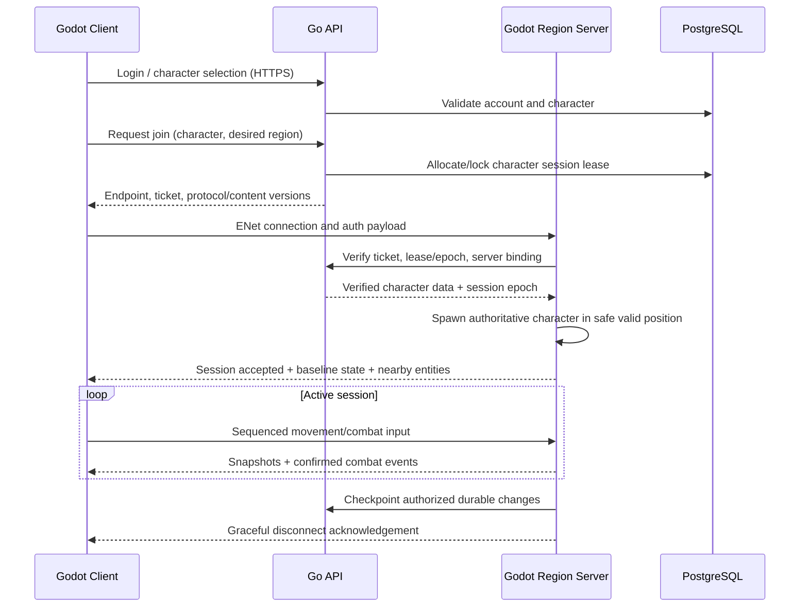

# Samurai Assassin — Multiplayer & Networking Specification

> **Status:** v0.1 network design for validation, not performance claims  
> **Client:** Godot 4.x / GDScript · **Real-time authority:** Godot 4.x headless / GDScript · **Control & persistence:** Go  
> **Related:** [GDD.md](GDD.md) · [ARCHITECTURE.md](ARCHITECTURE.md)

## 0. Agreed networking decisions

| Concern | Baseline |
|---|---|
| Topology | Dedicated server, never player-host authoritative |
| Simulation owner | Headless Godot region server |
| Control plane | Go services via HTTPS/internal authenticated API |
| Gameplay transport | Godot ↔ Godot high-level multiplayer over ENet/UDP |
| Go interoperability | Separate HTTPS/JSON (or other separately versioned control) API; Go does **not** speak Godot scene-RPC protocol |
| Simulation tick | **30 Hz target initially**, measured before tuning |
| Rendering | Independent client FPS; remote actor interpolation |
| Inputs | Client submits intentions with sequence numbers |
| Movement | Client predicts own movement; server re-simulates/validates and reconciles |
| Combat | Server controls hit detection, posture, damage, crowd control, death and cooldowns |
| Economic changes | Godot authorizes world rules; Go durable ledger commits transactions |
| Player-count target | Prototype at 2–8, initial load bracket 20–40; larger count requires proof |
| Death drops | Unsecured carried inventory only; equipped items and socketed gems protected |
| Joining | Authenticated short-lived ticket, server-issued character session lease |

This document describes **intended behavior** and acceptance tests. Packet field names are illustrative until the Godot scripts/contracts implement and validate them.

## 1. Session lifecycle



### Joining safeguards

- Ticket binds `account_id`, `character_id`, `server_instance_id`, expiry, nonce, protocol/content compatibility and optionally region/party.
- Server verifies ticket, checks current lease epoch, then associates connection peer ID with a character. **Never use Godot ENet peer ID as persistent account identity.**
- An already active character session cannot be replaced silently by a second connection. Support an explicit reconnect/takeover policy with old epoch revocation.
- Unknown or incompatible versions are rejected before any world mutation.
- Character spawns only after authoritative persistence state loads; no client-sent free-form inventory.

## 2. Network authority model

### What clients can send

**Intents**, not results:

- move axis, look/aim, sprint, jump, dodge, guard, parry and stance-switch intents;
- ability slot activation and optional aim/target hints;
- interaction requests (open container, pick item ID, activate gate, use scroll);
- party/chat/social requests subject to validation;
- cosmetic display preferences, never collision/hitbox sizes.

### What clients cannot authoritatively send

- new position/teleport outcome, collision bypass, attack damage, hit confirmation, health change, posture damage, cooldown reset, Spirit gains, item spawn, reward ownership, skill mastery, currency increase or respawn position.

### Server checks on every important action

Authenticated peer, correct region, entity alive/valid, state transition allowed, last accepted input sequence, rate limit, equipment loadout snapshot, safe-zone/PvP rule, stamina/Spirit cost, cooldown, hit reach, targeting constraints, affected targets and transaction eligibility.

## 3. Channel and message design

Godot ENet's high-level RPC provides reliability settings and channel support. Do not mix large reliable payloads into a channel where they can stall time-sensitive updates.

| Message family | Direction | Delivery guidance | Example |
|---|---|---|---|
| Input commands | Client → server | Frequent small **unreliable** or unreliable-ordered stream with sequence numbers; resend only essential state flags | move, aim, attack button, dodge |
| State snapshots | Server → client | **Unreliable-ordered** or comparable latest-state semantics | transform, velocity, health/posture quantized |
| Combat event results | Server → interested clients | Reliable for decisive one-time results; some purely presentational cues may be lossy | hit confirmed, parry, guard break, death |
| Inventory/progression mutations | Server ↔ client | Reliable, revisioned, idempotent authoritative result | loot pick, skill learn, bank |
| Lifecycle/control | Both | Reliable | join-ready, spawn/despawn, region switch |
| Chat/party | Both | Reliable, separately rate limited | party invites, text messages |

Avoid assuming Godot-specific ENet channels are an external interoperable protocol. Allocate channel IDs in a single documented manifest after verifying the pinned engine version and packet semantics. Reliable payloads may be delivered late; animation should not wait on nonessential cosmetic packets.

### Example input payload (conceptual)

```text
InputCommand {
  session_epoch: uint32
  sequence: uint32
  client_tick: uint32
  move_x: int8                  # quantized -127..127
  move_y: int8
  look_yaw: uint16             # quantized facing
  actions_pressed: bitset      # edge-triggered inputs
  actions_held: bitset         # guard, sprint, etc.
  ability_slot: uint8?         # 0..5
  predicted_target_id: uint32? # hint, not trusted
}
```

Do not send the entire inventory or character scene tree at tick frequency. Quantize where accurate enough; enforce maximum payload size and protocol version.

### Example snapshot payload (conceptual)

```text
WorldSnapshot {
  server_tick: uint32
  ack_input_sequence: uint32
  baseline_id: uint32?
  entity_changes[]: {
    entity_id, position, yaw, velocity, movement_state,
    combat_state, health, posture, status_flags, state_revision
  }
  relevancy_enters[]
  relevancy_leaves[]
}
```

The initial prototype can use straightforward RPC dictionaries or typed arrays in GDScript. Optimize packing/binary representations only after measuring bandwidth/GC and verifying compatibility. Avoid untrusted object deserialization or passing arbitrary resources across the network.

## 4. Simulation timing

### Tick model

- World server advances at a fixed tick interval (initial planning: `1/30 s ≈ 33.3 ms`).
- Inputs are buffered to the next appropriate server tick; late inputs follow a defined limited grace policy.
- Attack windup/active/recovery, posture effects and status expiration use **server simulation time**, not user wall-clock timestamps.
- Godot client runs render/animation updates at its own frame rate; gameplay predictions use simulation-step semantics.
- Profiling tracks p50/p95/p99 tick time, backlog and overrun count; if p95 approaches the budget, improve simulation/interest management or lower actor density before increasing player count.

### Update budget proposals to benchmark

- Simulate local combatants and projectiles at authoritative tick cadence.
- Send relevant near-player state more frequently than distant idle objects; e.g. test 10–20 snapshots/s for active remote players and lower for ambient entities.
- Send reliable immutable events when they occur rather than every frame.
- Avoid a global 30 Hz full-world replication to all players.

No asserted tick rate, population capacity, ping compensation or bandwidth figures should be marketed until measured on the target host/network.

## 5. Movement prediction, reconciliation and interpolation

### Local player flow

1. Read user input at client simulation tick; label with monotonic input sequence.
2. Immediately simulate movement locally for responsive controls (cosmetic prediction allowed).
3. Send buffered input command(s) to the server.
4. Server validates movement intent and steps authoritative `CharacterBody3D` movement/physics.
5. Server replies with state and last accepted input sequence.
6. Client corrects to authoritative state, replays remaining unacknowledged inputs and smooths visual correction.

**Do not predict durable outcomes.** Client may show a tentative hit/spark, but health, death, loot, skill learn and rewards require server confirmation. Large corrections, repeated divergence or impossible velocities become telemetry signals.

### Remote players

Buffer the most recent authoritative states and interpolate a short period behind server time. Use limited extrapolation only for missing packets and stop when data is too stale. Remote actor hitboxes during rendering do not define server hit outcomes.

### Physics consistency

Because both game client and server run Godot/GDScript, shared movement rules are practical, but frame-time differences, collisions and floating-point behavior can still diverge. Always reconcile; do not assume deterministic physics across machines.

## 6. Server-authoritative melee combat

### Attack lifecycle

```mermaid
sequenceDiagram
    participant A as Attacker Client
    participant S as Godot Server
    participant D as Defender Client
    A->>S: Attack/ability intent + sequence
    S->>S: Validate state, cost, cooldown, weapon, zone
    S-->>A: Confirm/replicate attack start
    S-->>D: Attack start animation/event
    S->>S: Advance windup; sample authoritative hit volume
    S->>S: Evaluate range, LOS, team/PvP, dodge/parry, posture
    S-->>A: Confirmed hit/miss/parry event
    S-->>D: Authoritative damage/posture + reaction event
    S->>S: Death check and durable drop flow if required
```

### Hit detection policy

- Server uses authored active frames and collision shapes/rays for attacks; no `client_reports_hit(target)` as authority.
- Attack reach and arcs originate from authoritative character state; include collision masks and obstacle/line-of-sight policy.
- Parry windows and dodge invulnerability use server state; client feedback may be optimistic but final result is server-owned.
- Record attacker entity, weapon/ability definition ID and version, server tick, target entity, outcome and enough state for troubleshooting.
- Every target hit has an ability-scoped deduplication key to prevent repeat hits from repeated overlap callbacks.

### Latency compensation

Melee parry timing is especially sensitive to ping. Start with **measured server-authoritative windows** and client prediction of local VFX, then test a bounded rewind/lag-compensation technique if high-latency play feels unfair:

- Keep a small history of recent validated actor transforms/combat flags.
- Use server-calibrated input timing and a strict maximum rewind window; do not trust arbitrary client timestamps.
- Never rewind durable inventory/progression state.
- Prevent attackers with high latency from hitting impossible targets long after they escaped.
- Evaluate defensive fairness separately from attacker favor; do not universally favor the attacker.

Lag compensation is a design experiment, not an invisible guarantee. Measure at several artificial RTT/loss/jitter settings.

### Technique weaving and passives

Skill effects, gem passive triggers, resonance and buff scroll modifiers execute on the server from the authoritative equipped/loadout snapshot. Trigger keys prevent repeated activation from duplicate packets. Status effects have sources, stacking groups, expiration times and proc limits. Passive activation must never recursively trigger an unbounded chain.

## 7. Area of interest (AOI) and replication

**Goal:** only send an assassin what matters nearby or for their UI.

- Use server-owned spatial grid/cells and a neighborhood query to create an **interest set** per client.
- Include visible/relevant nearby players, NPCs, interactables, boss attacks, ground loot and special events; large boss telegraphs may be important beyond ordinary visibility distance.
- Use hysteresis: enter at shorter distance, leave at slightly longer distance to avoid rapid repeated spawn/despawn.
- Recompute sets at bounded frequency and when cells change; bound CPU work per tick.
- Use replication priority tiers: nearby duel > nearby hostile projectiles > other players > ambient NPCs > cosmetic effects.
- Initial baseline/full state on enter, delta or changed state thereafter; despawn on leave. Unique network entity IDs must not be recycled too early.
- Never reveal stealth-invisible players through transforms, combat debug flags or premature spawn messages. Server filters hidden information; hiding a mesh on the client is insufficient.

An AOI optimization does **not** change authoritative world simulation or who can deal damage. A player outside the viewer's AOI can still be simulated; server broadphase and event routing determine visibility and outcomes.

## 8. Inventory, loot and death protocol

### Authoritative item classes

`SECURED` (persistent stash), `EQUIPPED_PROTECTED` (active slots and socketed gems), `CARRIED_UNSECURED` (backpack), `WORLD_DROP` (loot container). See `GDD.md` for the player promise.

No client can reclassify an item by changing its UI. Server rejects loadout changes outside safe prep points and any mutation while dead/in combat unless rules explicitly allow it.

### Death transaction (critical path)

```mermaid
sequenceDiagram
    participant C as Victim/Observers
    participant S as Godot Server
    participant G as Go Inventory Ledger
    participant DB as PostgreSQL
    S->>S: Confirm authoritative defeat; freeze victim interactions
    S->>S: Identify eligible carried items and server session epoch
    S->>G: DeathDrop(request_id, char_id, revision, eligible_items, location)
    G->>DB: Atomic compare-and-swap item ownership & create loot container
    alt Commit succeeds
        DB-->>G: committed transaction, container_id, new revision
        G-->>S: success + committed contents
        S-->>C: Death result; protected equipment retained; container spawned
    else Retriable failure/time-out
        G-->>S: failure/unknown
        S->>S: Keep inventory frozen; retry same request_id / query status
        S-->>C: Death pending, no duplicate loot advertised
    end
```

**Invariant:** each item instance exists in exactly one durable location; the death request is applied **at most once** through a stable idempotency key. Never announce loot before ledger commit. If a response is lost, fetch the operation status or retry the exact request, not a new request ID. Equipped gems remain under their protected parent weapon.

### Pickup transaction

1. Client requests to pick a known `world_item_id`/container slot.
2. Godot checks alive, range/LOS, realm rules, claim eligibility, carry capacity, container state and rate limit.
3. Godot establishes a short server-side reservation to prevent spam races.
4. Go performs transaction with item revision + idempotent request ID, moving from `WORLD_DROP` to the character's `CARRIED_UNSECURED` state.
5. Godot acknowledges one winner and updates interested clients. Losers see `already claimed` and never gain a local durable copy.

### Banking and learning

Only at allowed safe points: Godot validates safe zone and player state; Go atomically moves carried loot to secured stash, or consumes an unsecured skill scroll and creates a permanent `learned_skills` record. UI displays confirmed result. Never permit bank/learn-by-API from an arbitrary remote position without server session and location proof.

### Economy interruption policy

For authoritative item transactions, **fail closed** during DB outage. If a death/drop operation is pending, keep the relevant character/container locked and reconcile before resuming; do not silently forgive or duplicate an operation. Inform users about temporary unavailability and define an operator recovery procedure. For less critical Chronicle/analytics events, asynchronous outbox delivery is acceptable.

## 9. Disconnect, reconnect, crash and migration

### Unexpected client disconnect

- Region server marks character disconnected, starts a **short configurable grace period** and preserves its server-side combat/loot state.
- Avoid instant escape exploit: if in danger/combat, character may remain vulnerable for a short policy period; exact duration determined by playtests and fairness review.
- Same account/character can rejoin through Go-issued reconnect ticket bound to current session epoch; old peer revoked.
- When grace expires, apply defined safe logout/timeout policy (e.g., return to last sanctuary if not in combat; resolve dangerous logout via logged server state). No secret free extraction during combat.

### Server crash

- Go invalidates/ages out region lease after failed heartbeats, blocks new joins and starts reconciliation.
- Durable inventory/progression reflects only transactions committed in PostgreSQL.
- On restart, region reconstructs world from last durable checkpoint and authoritative transaction records. Discard uncommitted speculative rewards.
- Outstanding death/pickup operations are resolved by transaction ID, not replayed as new grants.
- Players reconnect to recovered instance or a safe staging region under an explicit rollback/compensation policy; do not claim crash-free persistence of every uncheckpointed world position.

### Region change

- First version: return to sanctuary, save/checkpoint, release lease and join another instance through Go.
- Later optional seamless transfer: two-phase source freeze, Go issues transfer token, destination loads durable state, ownership/epoch moves, source despawns after acknowledgement. Never allow both servers to control the same character.

## 10. Parties, PvP and special regions

- Go maintains durable/matchmaking party metadata; Godot server owns active combat membership and regional rules.
- Initial proposal: party friendly fire off; joining/leaving party is blocked while in combat or with pending loot claim.
- Party-based PvE rewards use explicit rules (contribution, round robin, personal instanced drops) and are not implicit shared unlimited items.
- Sanctuary rejects hostile combat inputs regardless of client visuals.
- At dangerous-zone border, server establishes authoritative zone state; client shows warning before entry; border crossing is not a client-sent boolean.
- Duel mode routes both players into consensual arena rules with no loot drop.
- No client may create or modify limited-holder technique ownership or bounty payoffs from an RPC; these need authenticated Go transactions and anti-abuse checks.

## 11. Networking security checklist

- Authenticate before spawning; validate every RPC sender, not only at initial connect.
- Rate-limit input and gameplay RPCs; reject unknown fields, absurd sizes, impossible sequence jumps, stale session epochs and malformed IDs.
- Validate action permissions server-side by current state and location.
- Never trust local times, stat modifiers, character models or equipment revision provided by client.
- Bind hitboxes and movement speed to server-approved assets/content IDs.
- Secure internal Go control API with private networking, TLS and signed/mutually authenticated identity.
- Throttle chat, report abuse, prevent resource-exhaustion payloads and avoid logging user secrets.
- Test duplication through disconnect races, server crashes, high latency and concurrent loot claims.
- Respect basic client privacy: Chronicle/kill-feed broadcasts only permitted player-facing data.

## 12. Test matrix

| Scenario | Test | Pass condition |
|---|---|---|
| 2-player duel | Both clients attack/parry at varied timings | One authoritative outcome; no client-forged damage |
| Packet loss | 1%, 3%, 5% loss + jitter | Movement remains playable within documented bounds; no item mismatch |
| High RTT | 50/100/200 ms simulated RTT | Reconciliation bounded; parry/attack fairness measured |
| Tampered input | Teleport position, invalid ability, exaggerated hit | Rejected/logged, no world mutation |
| Death loot | Kill with carried loot + protected sword/socket | Backpack transfers once; equipment remains |
| Double pickup | Two clients grab same gem at once | Exactly one durable claimant |
| Learn-then-die | Consume scroll, server confirms learning, then die | Skill retained, scroll consumed once |
| Crash after DB commit | Drop committed but ack lost | Retry resolves same container, no duplicate |
| Crash before DB commit | Server dies while transaction pending | No new items minted, account reconciles correctly |
| Multiple login | Same character connects from two clients | Single valid active epoch / takeover rules enforced |
| Interest boundary | Players move rapidly between cells | No visible ghost duplication / confidential stealth leak |
| Region PvP | Attack crosses sanctuary boundary | Server policy applies by authoritative location |
| Buff/skill spam | Spam multiple abilities and scroll use | Resource/cooldown caps enforced; no recursive passive loop |
| Late server packet | Packet reordered/delayed | Older snapshot does not overwrite newer state |
| Load test | 8 → 20 → 40 synthetic clients | Tick, bandwidth, CPU, failure rates recorded, no unsupported capacity claims |

## 13. Network profiling and acceptance framework

### Metrics

`server_tick_ms` p50/p95/p99, input age, buffered input count, snapshot bytes/client/sec, correction magnitude, RTT estimate, packet-drop estimates, interest set size, combat-event delivery latency, duplicate transaction attempts, join success %, reconnect success %, DB mutation latency and unresolved mutation count.

### Playable networking bar

- At low-latency local testing, sword contacts and posture events visibly match server state.
- At representative WAN latencies, input feels responsive without the server accepting impossible hits.
- Expected lost packets do not permanently desynchronize health or inventory.
- Under deliberately induced DB failure, durable items are not duplicated/lost to uncommitted actions.
- Scale target rises only after benchmark evidence with realistic player distribution, NPC count, abilities, boss VFX events and combat patterns—not empty clients standing idle.

## 14. GDScript RPC patterns (illustrative; not complete)

Use a small, stable set of RPC endpoints whose paths and signatures match on client and headless server. A script attached to a common path such as `/root/NetworkSession` can declare matching RPC stubs on both builds, with authority checks and different client/server execution paths.

```gdscript
# Concept only: implement sender validation, epoch, rate limits and tick queue.
# Client/server must have matching RPC declarations and scene paths.
@rpc("any_peer", "call_remote", "unreliable", 1)
func submit_input(seq: int, move: Vector2, action_bits: int) -> void:
    if not multiplayer.is_server():
        return
    var peer_id: int = multiplayer.get_remote_sender_id()
    if not is_authenticated_peer(peer_id):
        return
    if not input_is_valid(peer_id, seq, move, action_bits):
        return
    queue_authoritative_input(peer_id, seq, move, action_bits)

@rpc("authority", "call_remote", "unreliable_ordered", 2)
func receive_snapshot(server_tick: int, ack_seq: int, states: Array) -> void:
    if multiplayer.is_server():
        return
    apply_authoritative_snapshot(server_tick, ack_seq, states)
```

**Caution:** `is_authenticated_peer`, `input_is_valid`, `queue_authoritative_input` and `apply_authoritative_snapshot` are deliberately unspecified application functions, not built-in Godot methods. The snippet is a protocol sketch, not copy-paste production code. Validate exact RPC mode/transfer signatures against your pinned Godot version. A real input protocol will also include session epoch, bounded frame ranges, separate reliable action messages where needed and a proper replay/reconciliation implementation.

For persistent item changes, do **not** allow arbitrary `@rpc("any_peer")` methods to directly grant items. A request is only an intent; Godot server verifies gameplay state and Go commits authoritative changes.

## 15. Delivery stages

### P0 — Local deterministic test world

One client, one server simulation, simple sword moves, central hit rules, headless tests.

### P1 — Real 2-player server

Godot ENet RPC; login may be stubbed only locally; movement inputs, prediction, snapshots, replicated hit/parry/death. No persistent production item ownership yet.

### P2 — Secure admission + persistence

Go login/tickets, character leases, PostgreSQL, loadout snapshots, atomic death and pickup. No player-facing rare content until the ledger is safe.

### P3 — Combat and content networking

Six-slot loadout, gem passives, buffs, skill learning, status stack limits, boss attacks and AOI. Test abusive actions.

### P4 — Region operations and validation

Server directory, drain/restart/recovery, reconnect, synthetic load tests, collision/performance profiling and operator playbooks.

### P5 — Competitive alpha

Latency compensation experiments, party PvP rules, anti-griefing, event replication, Chronicle and controlled limited-holder ownership.

## 16. Protocol decisions still requiring evidence

- Pinned Godot minor/patch version, number of actual ENet channels, snapshot serialization schema.
- Simulation tick 30 vs 60 Hz based on melee feel and server CPU.
- Movement replay windows, smoothing constants and handling of animation root motion.
- Whether rewind compensation improves parry fairness or enables abuse at high RTT.
- AOI cell size, interest refresh rate and priority budgets.
- Exact disconnect-in-combat vulnerability window, logout policy and region transfer scope.
- Inventory transaction failure UX and deterministic server-side recovery after a crash.
- Whether voice chat is needed; if yes, use an isolated system with explicit consent/privacy, not the gameplay packet channel.

---

**Networking rule:** The Godot server decides what happened in the world. Go decides what durable item/progression mutation is committed. The client shows and predicts what the player experiences. No subsystem may grant itself both the authority to invent a valuable item and bypass the ledger.
